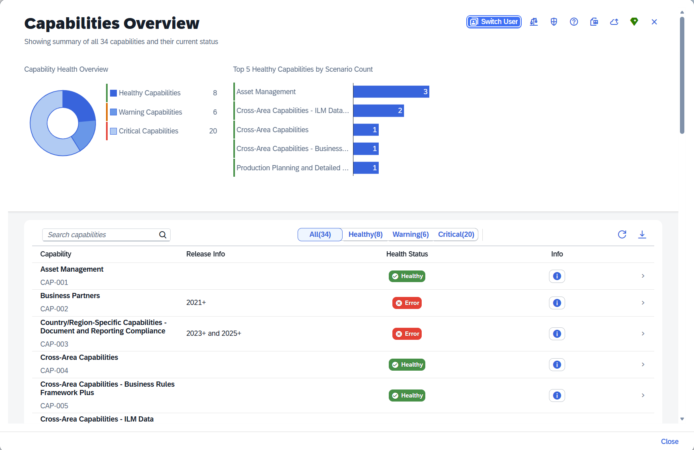
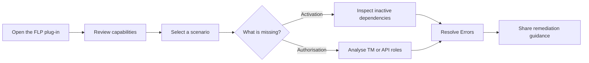

# Readiness Inspection and Guidance Tool for Joule Scenarios

**Verify Joule readiness. Investigate and quickly resolve authorization and activation issues.**

This tool analyses SAP Joule scenario prerequisites and identifies common configuration, activation, and authorisation issues in SAP S/4HANA landscapes. It is a diagnostic SAP Fiori Launchpad plug-in that makes the dependencies of every Joule capability visible and guides administrators from a high-level health overview to issue identification and resolution (where necessary).

> **Deployment scope:** The supplied installation guide specifies **SAP S/4HANA 2023** (Private Cloud Edition, FPS00 or higher), **Customer Managed Joule**, and **sandbox/development-only installation**. **Do not deploy to production based on this documentation.** See [Prerequisites and installation](docs/installation.md). NOTE: This tool is READ only.

*Capabilities Overview — consolidated activation and authorisation health across Joule capabilities (example system data).*

## 🔍 Why this tool?

A Joule scenario can be available to reference data but still fail for a particular user. The reason may be an inactive OData service, an unavailable SAP Fiori navigation target, or missing authorisation. The tool brings these checks together and guides administrators from a high-level health overview to the affected requirement and a remediation recommendation. The significant benefits provided by this tool will ensure quick resolutions to many common Joule issues.

### What you can do

| Discover | Investigate | Act |
| --- | --- | --- |
| View health across Joule capabilities and scenarios | Inspect OData APIs and intent-based navigation (IBN) targets | Follow guided activation and authorisation steps |
| Distinguish readiness from user access | Analyse target mappings, API authorisations and business roles | Save and export role recommendations |
| Examine another user's context in read-only simulation | Compare role coverage across scenarios | Refresh capability reference data from supported imports |

## 🚦 Understand the health indicators

**Two independent indicators** appear in the application:

| Indicator | Meaning |
| --- | --- |
| **Joule plug-in initialisation** | **Green:** Joule was detected and initialised in the FLP. **Red:** not detected or not successfully initialised. |
| **Capability/scenario health** | **Green — Healthy:** active and authorised. **Yellow — Warning:** active but at least one required authorisation is missing. **Red — Critical:** at least one required artefact is inactive; authorisation may also be missing. |

A critical scenario causes its containing capability to be critical. The user guide recommends resolving inactive artefacts before addressing access warnings. [See the status model](docs/overview.md#two-different-status-indicators).

## ✨ Key Tool capabilities

- **Capability and scenario overviews:** health statistics, search, filters and detailed drill-downs.

  > **Note:** Each capability and scenario is assigned a tool-generated reference ID (for example `CAP-001`, `SCEN-0076`) for internal handling and display. These do not correspond to any SAP Joule technical identifiers.

- **Scenario inspection:** activation and authorisation statuses for OData V2/V4 services and SAP Fiori IBN targets.
- **Context-user simulation:** examine a different user's access without changing their system settings.
- **Target Mapping Role Analyser (TMA):** trace navigation intents through catalogs to business and composite roles.
- **API Authorisation Analyser (APIA):** find business roles covering OData services, including the authorisation match type.
- **Resolve Errors:** turn detected issues and saved role selections into guided remediation steps.
- **Custom Role Analyser (CRA):** analyse the basic scenario coverage offered by selected roles.
- **Reference-data integration:** import Joule capability mappings and Admin Center scenario visibility data as distinct data sets.
- **Prompt Library:** browse and send documented Joule use-case prompts, subject to licensing and consumption considerations.

See the [complete feature guide](docs/features.md).

## 🗺️ How an investigation works

This is an **investigation workflow**, not an automatic fix: activation and role changes must be performed through the appropriate SAP administration processes.

## 🚀 Start here

| I want to… | Read |
| --- | --- |
| Understand the tool and terminology | [Overview](docs/overview.md) |
| Check compatibility and deploy to a development system | [Installation](docs/installation.md) |
| Explore individual screens | [Features](docs/features.md) |
| Find an issue affecting a user | [Common workflows](docs/workflows.md) |
| Understand role matches and security limits | [Authorisation analysis](docs/authorisation.md) |
| Refresh capability data | [Data synchronisation](docs/data-sync.md) |
| Investigate a failure | [Troubleshooting](docs/troubleshooting.md) |
| See what is supported and what needs validation | [Scope and limitations](docs/limitations.md) |

## 📸 Screenshots and example data

Screenshots illustrate the application in an example SAP landscape; displayed role names, capability counts and health results are not performance benchmarks. Before publishing, verify that the images and shown system values are cleared for public redistribution.

## 📖 Reference documentation

This Markdown documentation was drafted from the supplied original manuals. Consult them for detailed screen-by-screen instructions:

| Manual | Description |
| --- | --- |
| 📘 [User Guide & Feature Reference](docs/Readiness_Inspection_and_Guidance_Tool_for_Joule_Scenarios_User_Guide.pdf) | 28-page guide covering all screens, workflows and features |
| 📗 [Installation Guide](docs/Readiness_Inspection_and_Guidance_Tool_for_Joule_Scenarios_Installation_Guide.pdf) | 15-page guide covering prerequisites, abapGit import and PFCG role setup |

The [source mapping](docs/source-notes.md) identifies which manual pages correspond to each Markdown topic.

## ℹ️ Project information

- **Implementation:** SAP Fiori Launchpad plug-in (SAPUI5, minimum UI5 version 1.136.0) with ABAP repository objects, imported through abapGit.
- **Licence:** See [LICENSE](LICENSE) for copyright and licence information.

> **Important:** This tool checks readiness and basic access-related prerequisites; it does **not** prove that a business process is functionally authorised end to end.

## 🤝 Support, Feedback, Contributing

This project is open to feature requests/suggestions, bug reports etc. via [GitHub issues](https://github.com/SAP/readiness-tool-for-joule/issues). Contribution and feedback are encouraged and always welcome. For more information about how to contribute, the project structure, as well as additional contribution information, see our [Contribution Guidelines](CONTRIBUTING.md).

## 🔒 Security / Disclosure

If you find any bug that may be a security problem, please follow our instructions at [in our security policy](https://github.com/SAP/readiness-tool-for-joule/security/policy) on how to report it. Please do not create GitHub issues for security-related doubts or problems.

## 📜 Code of Conduct

We as members, contributors, and leaders pledge to make participation in our community a harassment-free experience for everyone. By participating in this project, you agree to abide by its [Code of Conduct](https://github.com/SAP/.github/blob/main/CODE_OF_CONDUCT.md) at all times.

## ℹ️ About this project

The Readiness Inspection and Guidance Tool for Joule Scenarios is an independent open-source project, not an official SAP product or SAP-certified solution.

- **Intended use:** The tool is designed for technical evaluation and assessment in non-production SAP S/4HANA Private Cloud Edition environments, specifically sandbox and development systems. Production deployment is outside its intended scope.
- **Assessment results:** The tool provides technical readiness insights and actionable recommendations to help identify configuration, activation and authorisation gaps. Findings should be reviewed and validated in the context of the target SAP environment before implementing any changes.
- **Clean Core and compatibility:** The tool has not been certified for SAP Clean Core compliance. Compatibility with future SAP S/4HANA releases, upgrades and support packages is not guaranteed. Users should independently assess compatibility with their target release.
- **Security and authorisations:** Users should review required authorisations, technical dependencies and security implications before installation and follow applicable organisational security and data protection policies.
- **Support:** The project is not covered by standard SAP product support agreements or service-level commitments.

The software is distributed under the [Apache License 2.0](LICENSE), which contains the applicable warranty and liability provisions.

## 📄 Licensing

Copyright 2026 SAP SE or an SAP affiliate company and readiness-tool-for-joule contributors. Please see our [LICENSE](LICENSE) for copyright and license information. Detailed information including third-party components and their licensing/copyright information is available [via the REUSE tool](https://api.reuse.software/info/github.com/SAP/readiness-tool-for-joule).
