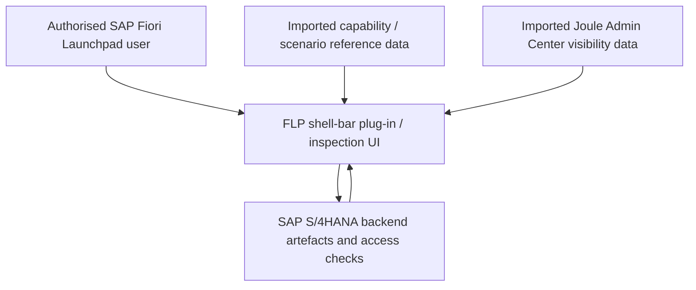

# 🏗️ Conceptual architecture and data flow

> **Documentation status:** This is a **high-level logical view**, assembled from the two supplied manuals and verified against the abapGit repository objects. It is **not** a complete class-level, CDS-level or API contract diagram. Further implementation-specific claims must be verified by inspecting the source code and consulting the project maintainers.

## Verified implementation details

The following facts are confirmed from the repository objects in this abapGit export:

| Object | Detail |
| --- | --- |
| UI technology | SAPUI5 FLP plug-in (`sap.flp` type `"plugin"`) |
| UI5 application ID | `dr.joule.assistant.drjoule` |
| Minimum UI5 version | 1.136.0 |
| Backend OData service | OData V2 — Service Binding `ZAPI_JOULECAPABILITY_O2`, Service Definition `ZAPI_JOULECAPABILITY` |
| Transaction code | `ZJOULEINSPECTOR` (parameter transaction launching the FLP app) |
| Root ABAP package | `ZDR_JOULE` (structure package); description: *Readiness Inspection and Guidance Tool for Joule Scenarios* |
| PFCG role export | `Z_BR_JOULE_INSPECTOR.SAP` |
| Sub-packages | `zdr_apia` (API analyser), `zdr_cra` (Custom Role Analyser), `zdr_dep_ana` (SAPUI5 dependency analyser), `zdr_joule_be` (backend services), `zdr_joule_ctx` (context-specific entities), `zdr_rap_xlsx` (Excel utility), `zdr_roles_ana` (roles analysis), `zdr_tma` (TM/catalog/role recommender), `zdr_ui` (UI) |
| Supported locales | English (default), Danish, German, Hindi, Portuguese, Brazilian Portuguese |

## Conceptual responsibilities

| Component / source | What the manuals establish |
| --- | --- |
| FLP plug-in | Provides the dialog, dashboards, scenario drill-downs, analysers and guided troubleshooting |
| Backend ABAP objects | Imported using abapGit into `ZDR_JOULE`; OData V2 service binding `ZAPI_JOULECAPABILITY_O2` is the main API |
| SAP landscape | Supplies system and user context for activation/authorisation diagnostics |
| SAP Note 3523238 import | Supplies capability/scenario mappings to API and IBN requirements |
| Joule Admin Center import | Supplies scenario visibility-condition information |
| PFCG role | `Z_BR_JOULE_INSPECTOR` grants authorised users access to the tool, following import/profile generation and assignment |

## What is deliberately not asserted here

The complete ABAP dependency graph, database tables, runtime services, caching, authentication trust boundaries, performance behaviour and precise authorisation-check algorithms are not documented here. These should be expanded only after inspecting the full repository implementation and verifying with maintainers.

[← Documentation index](README.md)
