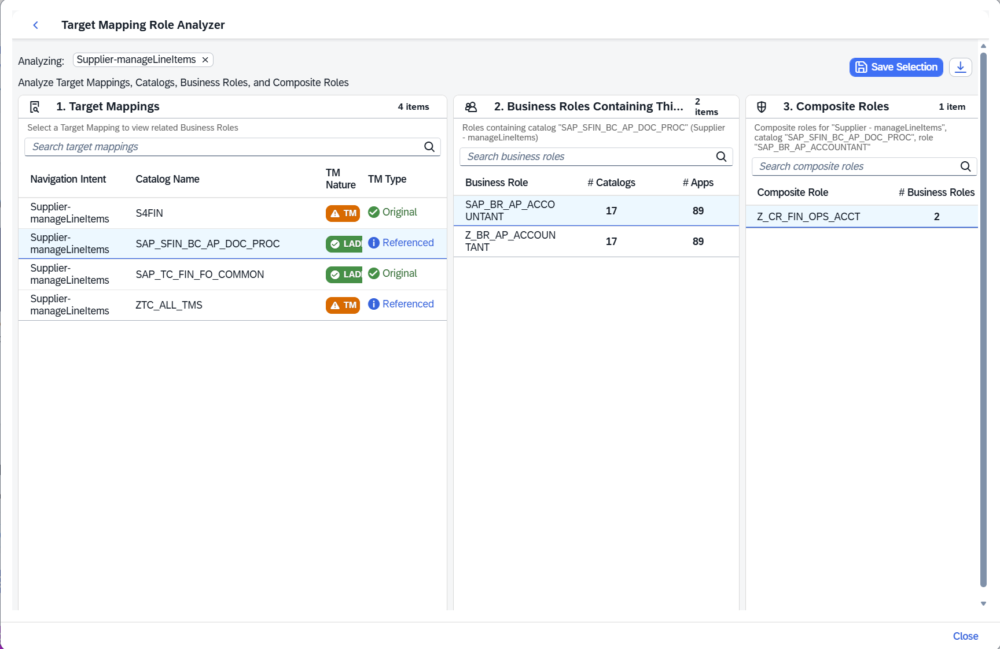
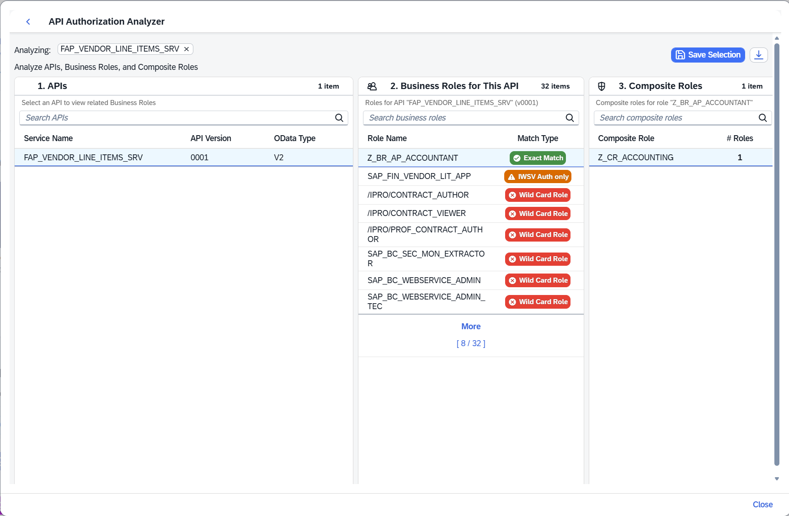
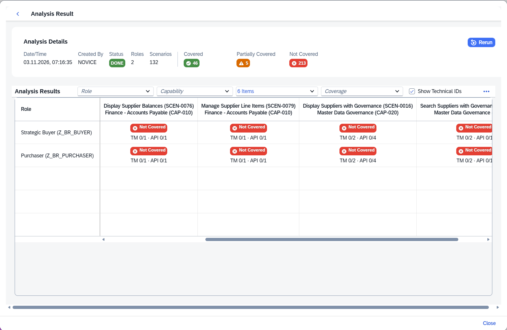

# 🔐 Authorisation analysis

This tool helps identify missing **basic prerequisite authorisations** for Joule scenarios. All assignments and changes to PFCG roles remain administrator actions in the target landscape.

## Target Mapping Role Analyser (TMA)

Launch TMA with **Analyze Missing IBN Targets** from a scenario, or inspect a specific unauthorised IBN target. Its three columns represent:

1. **Target mappings** matching the semantic object/action, including the catalog and mapping type.
2. **Business roles** containing the selected mapping's catalog.
3. **Composite roles** containing the selected business role.

Use **Save Selection** to preserve the selected chain. Saved recommendations can be exported to Excel and shown in **Resolve Errors**. TMA distinguishes classic target mappings and CDM V2 Logical App Descriptor Items (LADI); original and referenced target mappings are also identified.

## API Authorisation Analyser (APIA)

Launch APIA with **Analyze Missing OData Auth** or inspect an individual API. Its columns follow **API → business role → composite role**. The service and business-role matching information is intended to help choose a narrowly scoped authorisation.

| Match type | Interpretation | Recommendation from the guide |
| --- | --- | --- |
| **Exact Match** | Role contains the exact required service authorisation | Prefer this option |
| **IWSG Auth only** | Service-group metadata side of the relevant SAP Gateway authorisation | Partial; verify complementary IWSV authorisation |
| **IWSV Auth only** | Service side of the relevant SAP Gateway authorisation | Partial; verify complementary IWSG authorisation |
| **Wild Card** | Broad service authorisation, potentially covering numerous APIs | Avoid for productive role design because of excessive access |

The supplied guide recommends using the most precise **S_SERVICE** authorisation match and cautions against wildcard permissions. Save role selections to carry them into **Resolve Errors**.

## Custom Role Analyser (CRA)

CRA checks whether one or more selected business roles provide basic authorisation coverage across Joule scenarios.

1. Select role names using type-ahead, import them from an Excel file, or combine both methods.
2. Choose **Standard** (immediate analysis) or **Background** (job-based analysis) mode.
3. Open the resulting entry in **Analysis History**.
4. Examine the role × scenario coverage matrix and select a cell to see missing requirements.

| Result | Meaning |
| --- | --- |
| Covered | Role meets the basic target mapping/API authorisation requirements for the scenario |
| Partially covered | Some but not all requirements are covered |
| Not Covered | The role does not meet the required coverage |

**Background mode is experimental.** The user guide states it has only been tested/validated with **SAP S/4HANA 2025**, and requires configured **bgPF**, **bgRFC**, an active BGPF inbound destination and `BGMC_DEFAULT` context. Use Standard mode if these prerequisites are missing.

**Critical limitation:** CRA does **not** check functional, business, organisational, application-specific or data-level authorisations and does not certify that a user can successfully complete a business process.

*The matrix screenshot shows coverage results, not the separate missing-requirements detail popover. Select a cell in the application to inspect missing requirements.*

## ⚠️ Interpreting recommendations

- Start with inactive artefacts; red health status takes precedence over warning status.
- For activation gaps, consult [Troubleshooting](troubleshooting.md) and the SAP activation procedures suggested by the tool.
- For authorisation gaps, prefer narrowly scoped role recommendations, then validate and assign them through your organisation's change-control process.
- Re-run the investigation after the system or user role assignments have been updated.

[← Documentation index](README.md)
