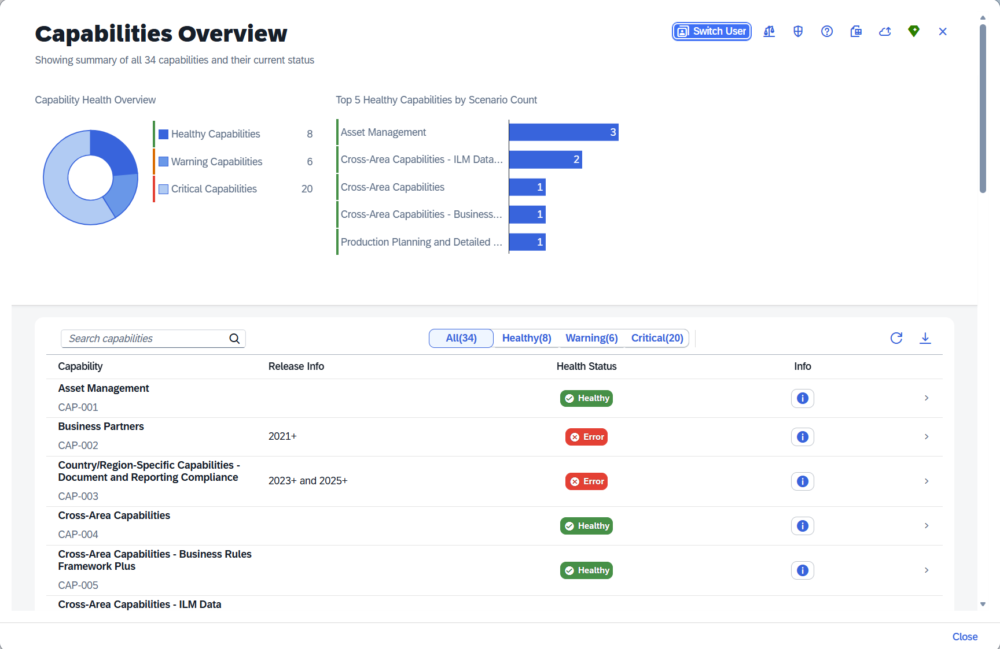
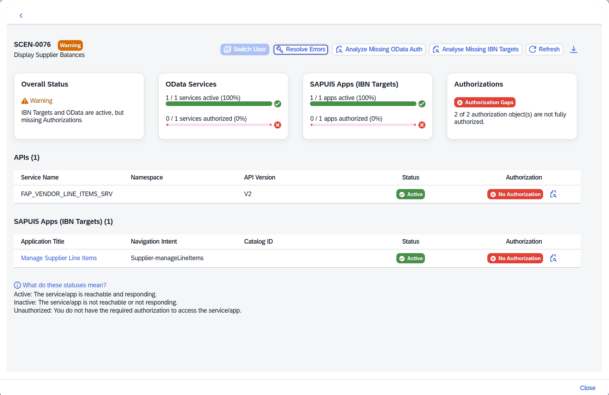
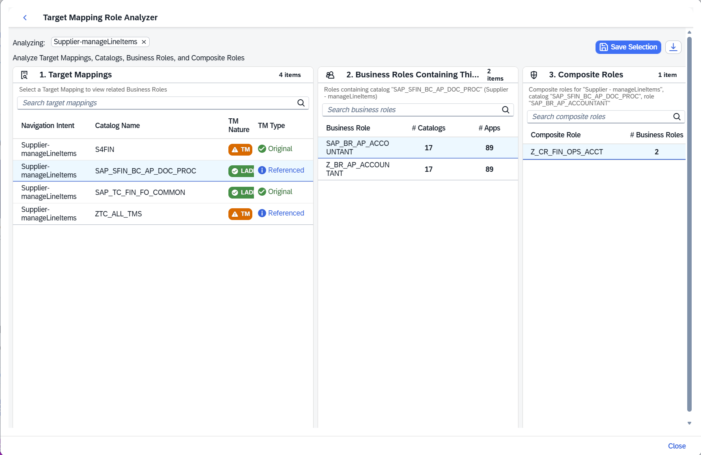
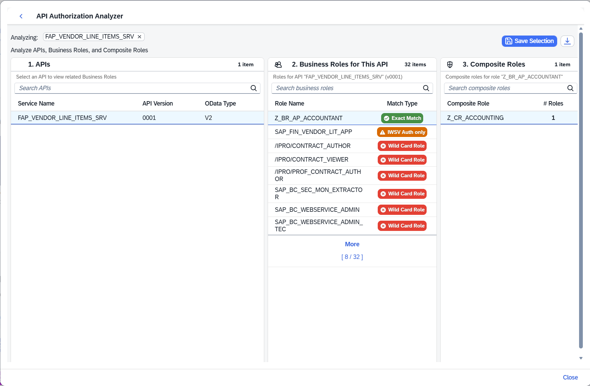
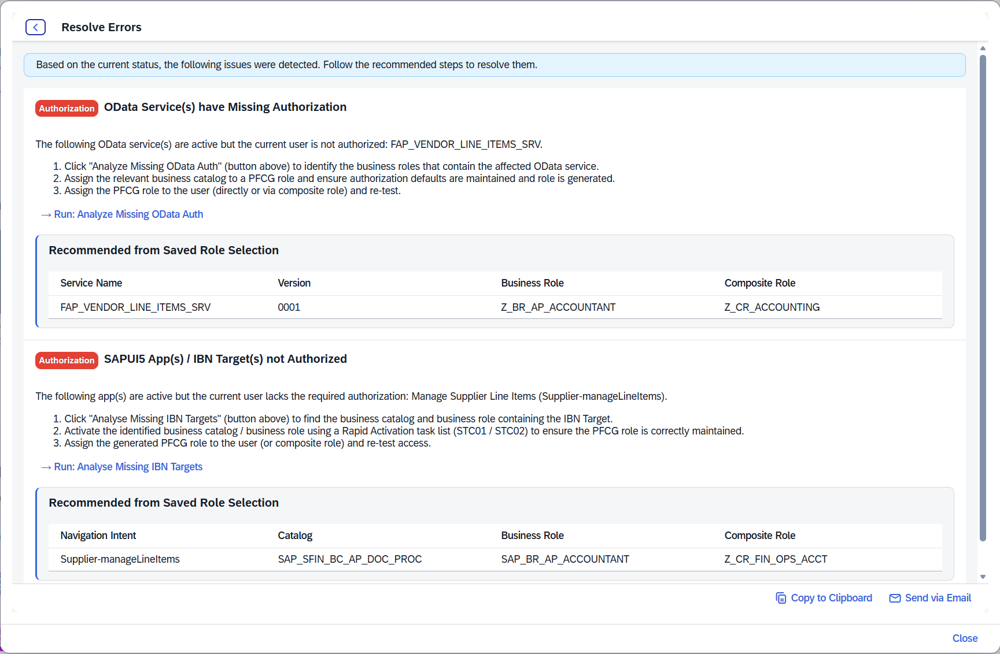
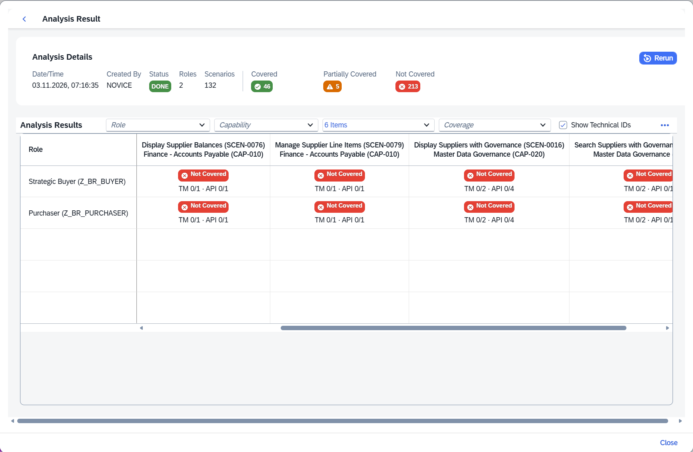

# ✨ Feature guide

This page introduces the screens at a level suitable for repository readers. For operational step-by-step procedures, use the [workflows](workflows.md) and [authorisation guide](authorisation.md).

## 1. Capabilities Overview

The landing page presents an overall health donut, top healthy capabilities, and a searchable/filterable capability list. Each row can open its scenarios; the information action gives a more detailed capability breakdown. The toolbar provides access to user switching, role comparison, CRA, the Prompt Library, data synchronisation and Admin Center import.

Each capability and scenario is assigned a tool-generated reference ID — for example `CAP-001` or `SCEN-0076` — used for internal handling and display. These IDs are not SAP Joule technical identifiers.

*Capabilities Overview — one place to identify healthy, warning and critical capabilities.*

## 2. Scenarios Overview

Selecting a capability shows its scenarios, scenario health counts and API/IBN activation information. Selecting a scenario opens its detail page.

## 3. Individual Scenario Detail

A scenario exposes **overall health**, **OData service activation**, **SAP Fiori IBN target activation**, and **user authorisation**. It identifies which service or app requires attention, with inspection actions for missing API or IBN access.

*Scenario Detail — the example scenario is active at service and app level but still has authorisation gaps.*

From this screen, users can open the **Target Mapping Role Analyser**, **API Authorisation Analyser**, **Activation Summary** where applicable, and **Resolve Errors**.

## 4. Context-user simulation

Administrators can select another user from the Capabilities Overview, after which the tool displays results in that user's context. A banner identifies the active simulation. Simulation is **read-only** and does not change customer-system settings. Return to the overview to switch users or cancel.

## 5. Target Mapping Role Analyser (TMA)

Starting from an unauthorised IBN target, TMA follows a three-column chain: **target mapping/catalog → business role → composite role**. Users can save chosen combinations and export the saved recommendations. [More detail](authorisation.md#target-mapping-role-analyser-tma).

*TMA — trace a navigation intent through its catalog, business role and optional composite role.*

## 6. API Authorisation Analyser (APIA)

APIA follows **OData service → business role → composite role**, including authorisation match type (exact, partial IWSG/IWSV or wildcard). Saved selections feed into remediation guidance. [More detail](authorisation.md#api-authorisation-analyser-apia).

*APIA — compare exact matches, partial service authorisations and wildcard matches before selecting a role.*

## 7. Activation Summary

For SAPUI5-type IBN targets reporting an activation warning, the Activation Summary shows relevant UI5 components and OData V2/V4 dependencies so that administrators can identify the partially active prerequisite.

## 8. Resolve Errors

The **Resolve Errors** action opens a remediation view with issue-specific steps for missing activation or authorisation. The supplied screenshot is titled **Resolve Errors** (the earlier user guide calls this view **Troubleshooting Help**). Saved TMA/APIA role selections appear within the relevant issue cards. The guidance can be copied or sent via the default email client.

*Resolve Errors — issue-specific guidance becomes more actionable when TMA/APIA role selections are saved.*

The guide helps administrators perform fixes; it does not automatically activate services or change PFCG roles.

## 9. Custom Role Analyser (CRA)

CRA evaluates selected business roles against Joule scenarios, then presents results as a coverage matrix. Role inputs can be selected by name or imported from Excel; analysis runs in standard mode or experimental background mode on supported/configured systems.

*CRA coverage matrix — summary counts cover all analysed combinations; the visible matrix cells show uncovered examples.*

CRA reports **Covered**, **Partially covered** and **Not Covered** for basic IBN/API authorisation requirements. It is not a functional or data-level authorisation test. [More detail](authorisation.md#custom-role-analyser-cra).

## 10. Data synchronisation and Admin Center import

The capability mapping from **SAP Note 3523238** can be uploaded/exported through **Capability Data Sync**. Separately, **Joule Admin Center scenario visibility data** can be imported. They represent different purposes and are **not interchangeable**. [More detail](data-sync.md).

## 11. Joule Prompt Library

A tree of published Joule use-case prompts supports sending a prompt as-is or editing it first. The manual advises checking licensing and consumption before productive use.

## 12. Role Federation Comparison

The Capabilities Overview includes a comparison action for role assignments across **S/4HANA, CDM V1, CDM V2 and Work Zone SCIM** sources. The supplied user guide names this feature but does not provide enough detail to document its exact matching rules or prerequisites. Those details should be verified against the source implementation before expansion.

[← Documentation index](README.md)
