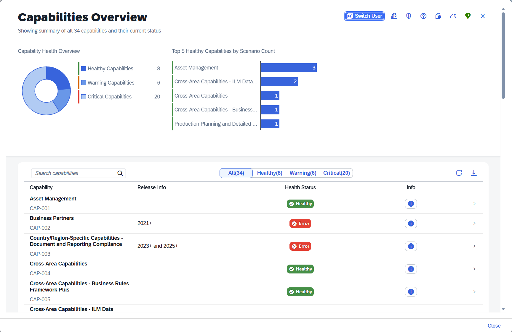

# Screenshot plan and image-slot catalogue

You do **not** need to upload all 70–80 product images. This is a curated list based on the user guide and installation guide. The six core product screenshots have now been supplied and integrated; only selected supporting images remain optional. A good public repository typically needs **8–12 high-quality screenshots**, rather than the entire image folder.

## How to supply screenshots

Place approved PNG/JPG images into `assets/images/` at the repository root, with the filenames below. The six **Included** images are already linked into their Markdown pages. For any additional image, replace its remaining **Image slot** callout with the example Markdown:

```md

```

From the root `README.md` the relative prefix is **`assets/images/`**, not `../assets/images/`. In files under `docs/`, use **`../assets/images/`**. **Do not add broken image links until the corresponding image has been supplied.**

## Included — the six core product screenshots

| ID | Filename to use | What the screenshot should show | Manual reference |
| --- | --- | --- | --- |
| <a id="img-02"></a>**IMG-02** | `capabilities-overview.png` | Clean home screen, health donut, top capabilities chart, capability list | User Guide p. 7 |
| <a id="img-05"></a>**IMG-05** | `scenario-detail.png` | Overview cards, APIs and IBN target statuses together; at least one issue visible | User Guide p. 11 |
| <a id="img-07"></a>**IMG-07** | `target-mapping-analyser.png` | TMA three-column chain, preferably one meaningful selected role | User Guide p. 13 |
| <a id="img-08"></a>**IMG-08** | `api-authorisation-analyser.png` | APIA three-column screen with Exact Match and other match types visible | User Guide p. 14 |
| <a id="img-09"></a>**IMG-09** | `resolve-errors.png` | Resolve Errors with saved role recommendations (new screenshot uses Resolve Errors as the view title) | User Guide p. 17 |
| <a id="img-11"></a>**IMG-11** | `role-coverage-matrix.png` | CRA results matrix; supplied image shows *Not Covered* cells plus aggregate Covered/Partially Covered/Not Covered counts | User Guide p. 24 |

**Status:** All six files above are present in `assets/images/` and referenced from the relevant Markdown pages. The main README uses `capabilities-overview.png`.

The supplied clean screenshots are preferred to annotated screenshots for the main repository overview. Additional annotated versions should only be included where a callout makes a procedure easier to follow.

## Optional next — supporting screens

| ID | Filename to use | What it should show | Manual reference |
| --- | --- | --- | --- |
| <a id="img-01"></a>**IMG-01** | `flp-launch-icon.png` | FLP top bar with the inspection plug-in icon next to Joule | User Guide p. 2 |
| <a id="img-03"></a>**IMG-03** | `health-status-examples.png` | Healthy, Warning and Critical examples without customer-specific values | User Guide p. 5 |
| <a id="img-04"></a>**IMG-04** | `scenarios-overview.png` | List of scenarios within a selected capability | User Guide p. 10 |
| <a id="img-06"></a>**IMG-06** | `context-user-simulation.png` | Switch User active with the yellow simulation banner | User Guide pp. 8–9 |
| <a id="img-10"></a>**IMG-10** | `custom-role-analyser.png` | CRA input selection and analysis-mode controls | User Guide p. 21 |
| <a id="img-12"></a>**IMG-12** | `capability-data-sync.png` | SAP Note reference-data upload + import history | User Guide p. 19 |
| <a id="img-13"></a>**IMG-13** | `admin-center-data-import.png` | Joule Admin Center import UI | User Guide p. 25 |
| <a id="img-14"></a>**IMG-14** | `prompt-library.png` | Prompt tree and play/edit actions | User Guide p. 18 |

## Optional later — installation detail

| ID | Filename to use | What it should show | Manual reference |
| --- | --- | --- | --- |
| <a id="img-15"></a>**IMG-15** | `abapgit-online-repository.png` | New Online Repository configuration, with any credentials hidden | Installation Guide p. 6 |
| <a id="img-16"></a>**IMG-16** | `active-service-binding.png` | ADT with service binding `ZAPI_JOULECAPABILITY_O2` active | Installation Guide p. 12 |
| <a id="img-17"></a>**IMG-17** | `pfcg-role-setup.png` | Imported inspector role and PFCG profile assignment area | Installation Guide pp. 13–15 |

## Image-quality checklist

- Capture the **original screen** if possible; avoid photographs of monitors and page-sized PDF screenshots.
- Use consistent crop, aspect ratio, display scaling and UI language.
- Prefer full-width, sharp PNG screenshots; avoid additional arrows/callouts baked into the picture when the Markdown caption is sufficient.
- Remove or mask customer names, email addresses, user IDs, hostnames, tokens and other sensitive data.
- Add descriptive alt text; keep images meaningful on both dark and light GitHub themes.
- Use screenshots only if approved for redistribution with the repository.
