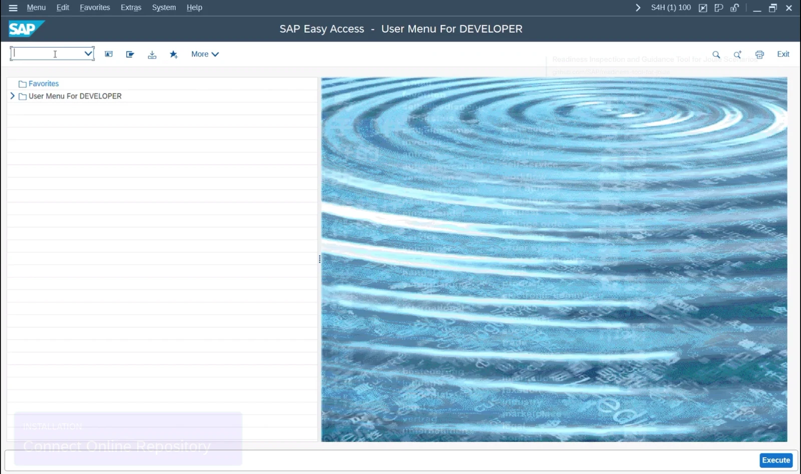
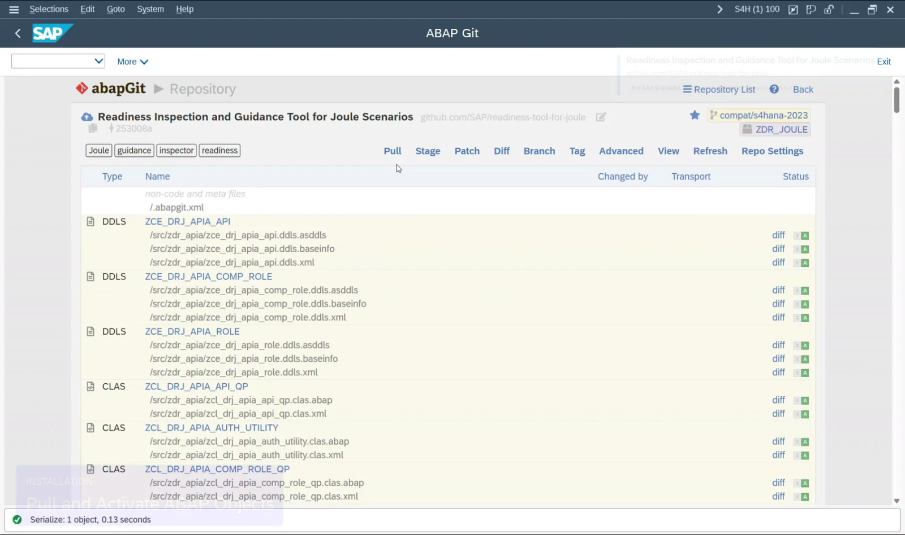
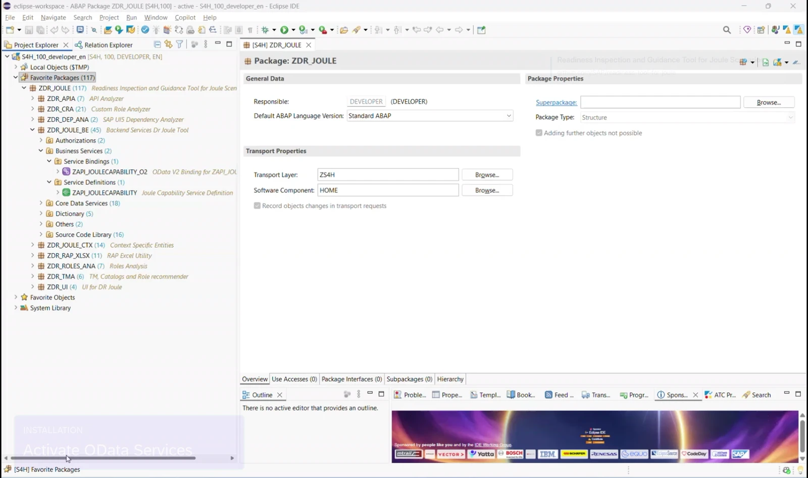
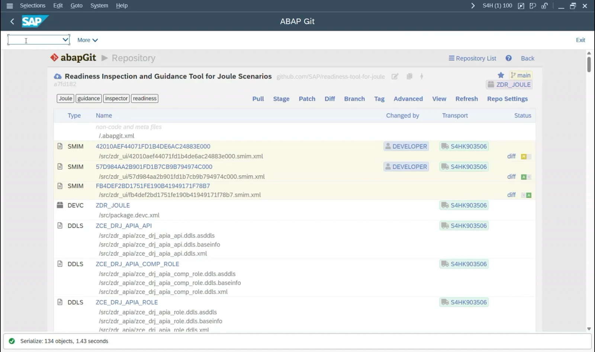

# 🛠️ Installation (development and sandbox systems)

> **Do not deploy to a production system.** The supplied Installation Guide explicitly restricts this tool to **sandbox or development** environments. The steps below describe the guide's installation procedure and should be validated against the current release and your landscape before execution.

## 🌐 Which SAP S/4HANA release?

| Release | Minimum supported | Branch | Installation guide |
| --- | --- | --- | --- |
| SAP S/4HANA 2025 | FPS00 | `main` | [2025 Installation Guide](https://github.com/SAP/readiness-tool-for-joule/blob/main/docs/installation.md) (this guide) |
| SAP S/4HANA 2023 | FPS01 | `compat/s4hana-2023` | [2023 Installation Guide](https://github.com/SAP/readiness-tool-for-joule/blob/compat/s4hana-2023/docs/installation.md) |

## ✅ Prerequisites

According to the provided installation guide:

- **Customer Managed Joule** is already deployed and configured.
- SAP **S/4HANA 2025** Private Cloud Edition, **FPS00 or higher**.
- **abapGit** is installed and accessible, including report `ZABAPGIT_STANDALONE`.
- Access to create an ABAP package, use a transport request, activate ADT objects and maintain PFCG roles.
- Network and SSL trust configuration necessary to connect abapGit to the Git repository.

## 1. Create the root ABAP package

In ADT/Eclipse, create a new **ABAP Package** (Ctrl+Shift+N):

| Setting | Value in the installation guide |
| --- | --- |
| Name | `ZDR_JOULE` |
| Description | `Readiness Inspection and Guidance Tool for Joule Scenarios` |
| Software component | `HOME` |
| Package type | **Structure** (required) |
| Transport layer | Appropriate to the development landscape |
| Transport request | Create/select a workbench request |

Check that the package has type **Structure**, not an ordinary development package.

▶ Watch demonstration: Create ABAP Package in ADT (28 seconds)

[Download full-quality demonstration (MP4)](../assets/videos/installation/01-create-abap-package-in-adt.mp4)

[Open dedicated demonstration page](videos/01-create-abap-package-in-adt.md)

## 2. Register the repository in abapGit

1. Run `ZABAPGIT_STANDALONE` using `SE38` or `SA38`.
2. Select **New Online**.
3. Enter the details documented below; verify the currently approved repository and branch before importing:

| Field | Guide value |
| --- | --- |
| Git URL | `https://github.com/SAP/readiness-tool-for-joule.git` |
| Package | `ZDR_JOULE` |
| Branch | `main` |
| Folder logic | `Full` |
| Display name | `Readiness Inspection and Guidance Tool for Joule Scenarios` |

4. Create the online repository and authenticate as required by the organisation's Git setup.
5. Review the object list, select **Pull**, inspect the import list and continue using the appropriate transport request.
6. On the **Inactive Objects** screen, **deselect** the Service Binding `ZAPI_JOULECAPABILITY_O2` so it can be activated manually in the next step.

The guide notes that an error relating to this service binding may appear immediately after the import; this is expected before the manual activation step.

▶ Watch demonstration: Create Online Repository in abapGit (28 seconds, covers steps 1–4)

[Download full-quality demonstration (MP4)](../assets/videos/installation/02-create-online-repository-in-abapgit.mp4)

[Open dedicated demonstration page](videos/02-create-online-repository-in-abapgit.md)

▶ Watch demonstration: Pull and Activate ABAP Objects (58 seconds, covers steps 5–6)

[Download full-quality demonstration (MP4)](../assets/videos/installation/03-pull-and-activate-abap-objects.mp4)

[Open dedicated demonstration page](videos/03-pull-and-activate-abap-objects.md)

### TLS / certificate errors

If the connection fails because the remote certificate is not trusted, the guide directs the administrator to obtain the proper certificate through their IT team and maintain the trust in `STRUST`. **Do not disable certificate verification** as a workaround. See [Troubleshooting: HTTPS connection errors](troubleshooting.md#abapgit-cannot-establish-a-trusted-https-connection) for step-by-step video walkthroughs of the certificate export and STRUST import process.

### Add package to ADT Favourites (optional)

To add `ZDR_JOULE` to the ADT Favourites view for easier navigation, right-click the package in ABAP Development Tools and select **Add to Favourites**.

▶ Watch demonstration: Add Package to ADT Favourites (31 seconds, optional)

[Download full-quality demonstration (MP4)](../assets/videos/installation/04-add-package-to-favorites-optional.mp4)

[Open dedicated demonstration page](videos/04-add-package-to-favorites-optional.md)

## 3. Activate the OData service artefacts

Using **ABAP Development Tools (ADT)**:

1. Open the object search (Ctrl+Shift+A) and find **Service Definition** `ZAPI_JOULECAPABILITY`; activate it.
2. Find **Service Binding** `ZAPI_JOULECAPABILITY_O2`; activate it separately.
3. Check the Service Binding's **General** tab and confirm its status is **Active**.
4. Return to abapGit and choose **Refresh** to synchronise status.
5. Confirm that the earlier service binding error no longer appears.

> **Note:** The Service Definition is named `ZAPI_JOULECAPABILITY` (without the `_O2` suffix); only the Service Binding carries the `_O2` suffix. Search for each object by its exact name to avoid confusion.

The guide notes that minor differences for `SMIM` objects can remain without affecting functionality. Treat any other errors as requiring review; do not automatically dismiss them.

▶ Watch demonstration: Activate OData Service in ADT (37 seconds)

[Download full-quality demonstration (MP4)](../assets/videos/installation/05-activate-odata-service-in-adt.mp4)

[Open dedicated demonstration page](videos/05-activate-odata-service-in-adt.md)

▶ Watch demonstration: Verify Repository Status in abapGit (16 seconds)

[Download full-quality demonstration (MP4)](../assets/videos/installation/06-verify-repository-status-in-abapgit.mp4)

[Open dedicated demonstration page](videos/06-verify-repository-status-in-abapgit.md)

## 4. Import and assign the PFCG role

1. Obtain **`Z_BR_JOULE_INSPECTOR.SAP`**, the role export named in the installation guide, from the approved repository release.
2. Open `PFCG` and use **Role → Upload**.
3. Import the role and open it in change mode.
4. In **Authorizations**, maintain the authorisation data as appropriate and **generate the profile**.
5. In **User**, assign the role to the intended test users and save.
6. If required, run **User Comparison** to synchronise the user master records.
7. Sign in to the SAP Fiori Launchpad and confirm the tool appears in the shell bar for authorised users.

▶ Watch demonstration: Download Authorisation Role from GitHub (18 seconds, covers step 1)

[Download full-quality demonstration (MP4)](../assets/videos/installation/07-download-authorization-role-from-github.mp4)

[Open dedicated demonstration page](videos/07-download-authorization-role-from-github.md)

▶ Watch demonstration: Import and Assign Authorisation Role (1 minute 2 seconds, covers steps 2–7)

[Download full-quality demonstration (MP4)](../assets/videos/installation/08-import-and-assign-authorization-role.mp4)

[Open dedicated demonstration page](videos/08-import-and-assign-authorization-role.md)

## ✅ Installation verification

- [ ] Development/sandbox environment and supported release confirmed
- [ ] Customer Managed Joule set up
- [ ] `ZDR_JOULE` structure package created
- [ ] abapGit import completed with reviewed object status
- [ ] Service Definition and Service Binding active
- [ ] PFCG profile generated and assigned
- [ ] FLP shell-bar tool icon appears to an authorised test user
- [ ] Basic Capabilities Overview loads after opening the tool

## ⚠️ Important limits

The installation guide does **not** document production deployment, upgrades, uninstall, rollback, automated testing or a complete security hardening procedure. Do not infer those procedures from this page. Please consult the project maintainers and release-specific instructions before making such changes.

[← Documentation index](README.md)
