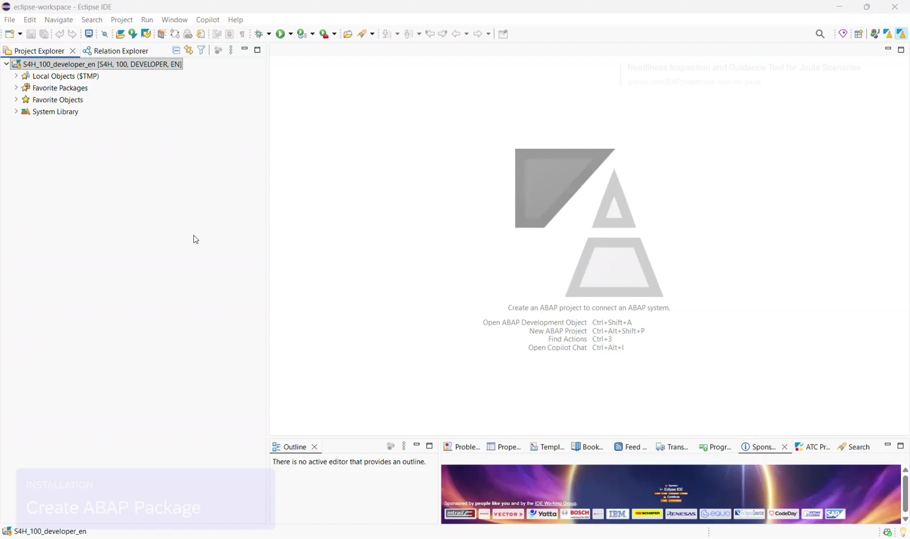
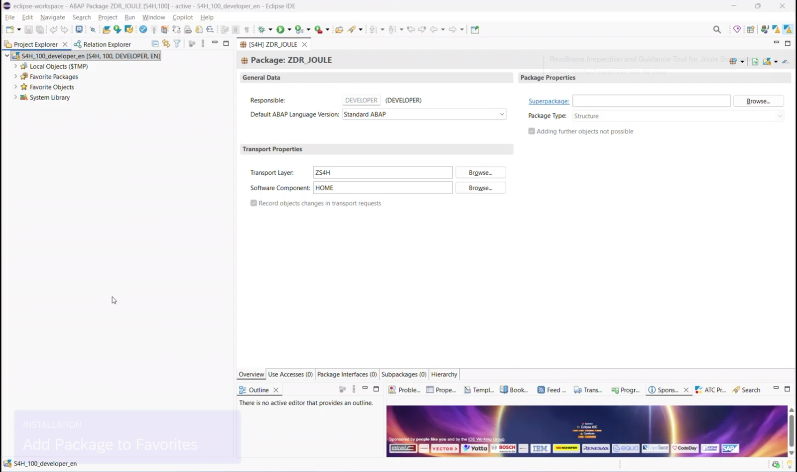
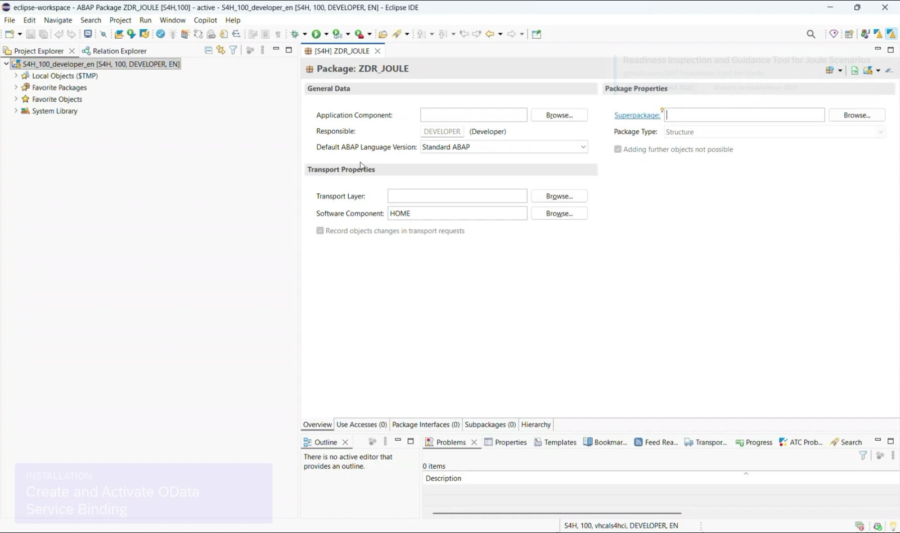
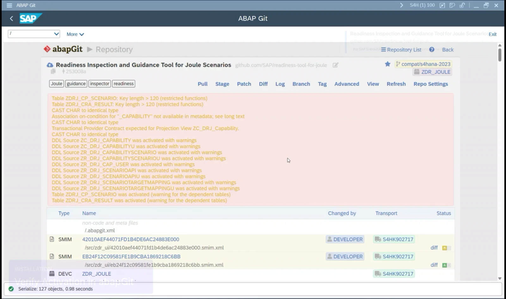
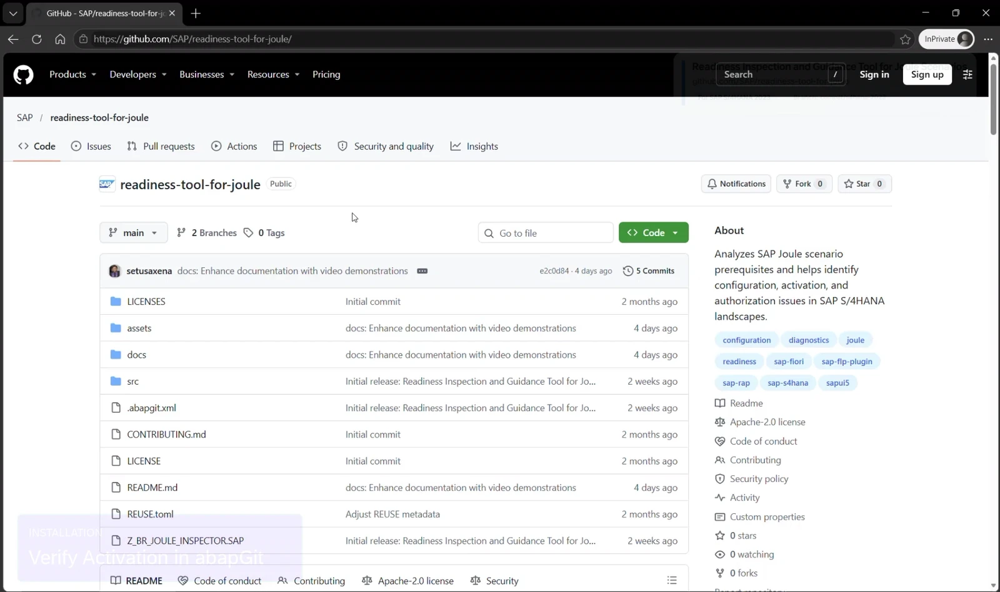

# 🛠️ Installation (development and sandbox systems)

> **Do not deploy to a production system.** The Installation Guide explicitly restricts this tool to **sandbox or development** environments. The steps below describe the installation procedure for the **SAP S/4HANA 2023** compatibility branch and should be validated against your landscape before execution.

## 🌐 Which SAP S/4HANA release?

| Release | Minimum supported | Branch | Installation guide |
| --- | --- | --- | --- |
| SAP S/4HANA 2025 | FPS00 | `main` | [2025 Installation Guide](https://github.com/SAP/readiness-tool-for-joule/blob/main/docs/installation.md) |
| SAP S/4HANA 2023 | FPS01 | `compat/s4hana-2023` | [2023 Installation Guide](https://github.com/SAP/readiness-tool-for-joule/blob/compat/s4hana-2023/docs/installation.md) (this guide) |

## ✅ Prerequisites

- **Customer Managed Joule** is already deployed and configured.
- SAP **S/4HANA 2023** Private Cloud Edition, **FPS01 or higher**.
- **abapGit** is installed and accessible, including report `ZABAPGIT_STANDALONE`.
- Access to create an ABAP package, use a Workbench transport request, activate ADT objects and maintain PFCG roles.
- Network and SSL trust configuration necessary to connect abapGit to the Git repository.

## 1. Create the root ABAP package

In ADT/Eclipse, create a new **ABAP Package** (Ctrl+Shift+N):

| Setting | Value |
| --- | --- |
| Name | `ZDR_JOULE` |
| Description | `Readiness Inspection and Guidance Tool for Joule Scenarios` |
| Software component | `HOME`, or the appropriate selection for your landscape |
| Package type | **Structure** (required) |
| Transport layer | Appropriate to the development landscape |
| Transport request | Create or select a Workbench request |

Check that the package has type **Structure**, not an ordinary development package.

▶ Watch demonstration: Create ABAP Package in ADT (28 seconds)

[Download full-quality demonstration (MP4)](../assets/videos/installation/01-create-abap-package-in-adt.webp.mp4)

[Open dedicated demonstration page](videos/01-create-abap-package-in-adt.md)

## 2. Register the repository in abapGit

1. Run `ZABAPGIT_STANDALONE` using `SE38` or `SA38`.
2. Select **New Online**.
3. Enter the details below; verify the repository and branch before importing:

| Field | Value |
| --- | --- |
| Git URL | `https://github.com/SAP/readiness-tool-for-joule.git` |
| Package | `ZDR_JOULE` |
| Branch | `compat/s4hana-2023` |
| Folder logic | `Full` |
| Display name | `Readiness Inspection and Guidance Tool for Joule Scenarios` |

4. Create the online repository and authenticate as required by your organisation's Git setup.
5. Review the object list, select **Pull**, inspect the import list and continue using the appropriate Workbench transport request.
6. On the **Inactive Objects** screen, **keep all imported objects selected** and continue with activation.
7. Review the activation results. Warnings relating to `SMIM` objects do not affect functionality; treat any other errors as requiring review.

> **Note:** The Service Binding `ZAPI_JOULECAPABILITY_O2` is **not delivered** through abapGit in this compatibility branch and therefore does not appear as an object to deselect. The Service Binding must be created, activated and published manually in ADT — see [Section 3](#3-activate-and-publish-the-odata-service) below.

▶ Watch demonstration: Create Online Repository in abapGit (29 seconds, covers steps 1–4)

[Download full-quality demonstration (MP4)](../assets/videos/installation/02-create-online-repository-in-abapgit.mp4)

[Open dedicated demonstration page](videos/02-create-online-repository-in-abapgit.md)

▶ Watch demonstration: Pull and Activate ABAP Objects (30 seconds, covers steps 5–7)

[Download full-quality demonstration (MP4)](../assets/videos/installation/03-pull-and-activate-abap-objects.mp4)

[Open dedicated demonstration page](videos/03-pull-and-activate-abap-objects.md)

### TLS / certificate errors

If the connection fails because the remote certificate is not trusted, obtain the proper certificate through your IT team and maintain the trust in `STRUST`. **Do not disable certificate verification** as a workaround. See [Troubleshooting: HTTPS connection errors](troubleshooting.md#abapgit-cannot-establish-a-trusted-https-connection) for step-by-step video walkthroughs of the certificate export and STRUST import process.

## 3. Activate and publish the OData service

The Service Definition `ZAPI_JOULECAPABILITY` is imported through abapGit. The Service Binding `ZAPI_JOULECAPABILITY_O2` is not delivered in this compatibility branch and must be created, activated and published manually in ADT.

### Add the package to ADT Favorites

To navigate to the Service Definition, first add `ZDR_JOULE` to the ADT Favorites view.

In Eclipse ADT, expand your ABAP project, right-click **Favorite Packages** and choose **Add Package**. Search for `ZDR_JOULE` and add it.

▶ Watch demonstration: Add Package to ADT Favorites (31 seconds)

[Download full-quality demonstration (MP4)](../assets/videos/installation/04-add-package-to-favorites.mp4)

[Open dedicated demonstration page](videos/04-add-package-to-favorites.md)

### Locate the Service Definition

In ADT, navigate through the package tree:

`ZDR_JOULE → ZDR_JOULE_BE → Business Services → Service Definitions`

Locate **`ZAPI_JOULECAPABILITY`**.

### Activate the Service Definition

Right-click `ZAPI_JOULECAPABILITY` and select **Activate**.

### Create the Service Binding

Right-click the Service Definition and select **New Service Binding**.

Configure the new Service Binding with these values:

| Property | Value |
| --- | --- |
| Package | `ZDR_JOULE_BE` |
| Name | `ZAPI_JOULECAPABILITY_O2` |
| Description | `OData V2 Binding for ZAPI_JOULECAPABILITY_O2` |
| Binding Type | **OData V2 - UI** |
| Service Definition | `ZAPI_JOULECAPABILITY` |

> **Important:** ADT may recommend **OData V4**. This tool requires **OData V2 - UI**. Do not change the Binding Type based on that recommendation.

Select an appropriate Workbench transport request and click **Finish**.

### Activate and publish the Service Binding

Open `ZAPI_JOULECAPABILITY_O2` in ADT and activate it using **Activate** (Ctrl+F3).

In the Service Binding editor, click **Publish** for the exposed OData service. Verify that publication completes successfully.

> **Note:** The Service Definition is named `ZAPI_JOULECAPABILITY` (without the `_O2` suffix); only the Service Binding carries the `_O2` suffix. Search for each object by its exact name to avoid confusion.

▶ Watch demonstration: Create and Activate OData Service Binding in ADT (1 minute 3 seconds)

[Download full-quality demonstration (MP4)](../assets/videos/installation/05-create-and-activate-odata-service-binding-in-adt.mp4)

[Open dedicated demonstration page](videos/05-create-and-activate-odata-service-binding-in-adt.md)

### Verify repository status

Return to abapGit and choose **Refresh** to synchronise the repository status. Confirm that the objects are in a clean state. Minor differences for `SMIM` objects do not affect functionality; treat any other remaining errors as requiring review.

▶ Watch demonstration: Verify Repository Status in abapGit (18 seconds)

[Download full-quality demonstration (MP4)](../assets/videos/installation/06-verify-repository-status-in-abapgit.mp4)

[Open dedicated demonstration page](videos/06-verify-repository-status-in-abapgit.md)

## 4. Import and assign the PFCG role

1. Download **`Z_BR_JOULE_INSPECTOR.SAP`** from the root of the [compat/s4hana-2023 branch](https://github.com/SAP/readiness-tool-for-joule/tree/compat/s4hana-2023).
2. Open `PFCG` and use **Role → Upload**.
3. Import the role and open it in change mode.
4. In **Authorizations**, maintain the authorisation data as appropriate and **generate the profile**.
5. In **User**, assign the role to the intended test users and save.
6. If required, run **User Comparison** to synchronise the user master records.
7. Sign in to the SAP Fiori Launchpad and confirm the tool appears in the shell bar for authorised users.

▶ Watch demonstration: Download Authorization Role from GitHub (24 seconds, covers step 1)

[Download full-quality demonstration (MP4)](../assets/videos/installation/07-download-authorization-role-from-github.mp4)

[Open dedicated demonstration page](videos/07-download-authorization-role-from-github.md)

▶ Watch demonstration: Import and Assign Authorization Role (53 seconds, covers steps 2–7)

[Download full-quality demonstration (MP4)](../assets/videos/installation/08-import-and-assign-authorization-role.mp4)

[Open dedicated demonstration page](videos/08-import-and-assign-authorization-role.md)

## ✅ Installation verification

- [ ] Development/sandbox environment and supported release confirmed
- [ ] Customer Managed Joule set up
- [ ] `ZDR_JOULE` structure package created
- [ ] abapGit import completed with reviewed object status (branch `compat/s4hana-2023`)
- [ ] Service Definition `ZAPI_JOULECAPABILITY` activated
- [ ] Service Binding `ZAPI_JOULECAPABILITY_O2` created, activated and published
- [ ] PFCG profile generated and assigned
- [ ] FLP shell-bar tool icon appears to an authorised test user
- [ ] Basic Capabilities Overview loads after opening the tool

## ⚠️ Important limits

The installation guide does **not** document production deployment, upgrades, uninstall, rollback, automated testing or a complete security hardening procedure. Do not infer those procedures from this page. Please consult the project maintainers and release-specific instructions before making such changes.

[← Documentation index](README.md)
