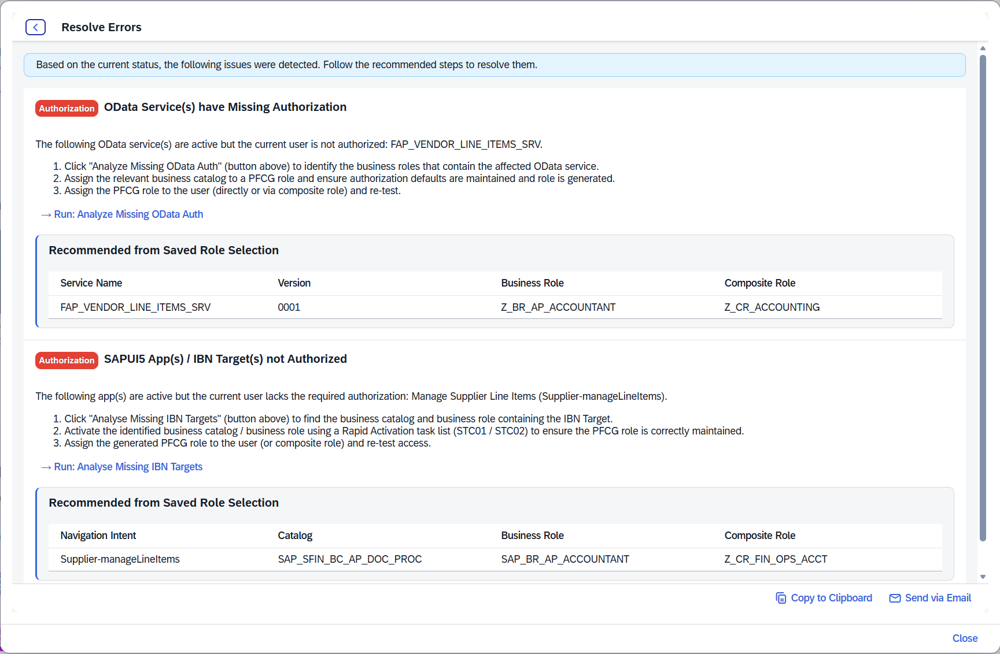

# 🔧 Troubleshooting

The tool provides **diagnostic guidance**. It does not automatically activate services, generate missing business catalogues or assign roles in the underlying SAP system.

## Joule plug-in indicator is red

A red **Joule plug-in initialisation** indicator means the Joule plug-in was not detected or could not initialise successfully. This status is **independent** of the green/yellow/red capability health indicators. Verify the customer's Joule FLP configuration and initialisation, then re-check the indicator.

## A capability or scenario is critical (red)

A critical status means at least one required IBN target or API is **inactive**. Open **Scenario Detail**, identify the failing requirement and use **Resolve Errors**. For relevant SAP Fiori app warnings, open **Activation Summary** to inspect UI5 and OData dependencies. The guide points administrators to rapid activation procedures such as `STC01`/`STC02`; use approved SAP administration practices in your environment.

## A scenario shows warning (yellow)

The dependencies are active but at least one API or IBN target is **not authorised** for the user. Use **APIA** or **TMA**, save suitable selections and inspect the recommendations in **Resolve Errors**. Prefer exact API authorisation matches rather than overly broad wildcard grants.

## An authorised user still cannot complete a business action

The tool and CRA assess readiness and **basic access-related prerequisites**, not all functional, organisational, application-specific or data-level authorisations. If all basic checks pass, investigate those separate controls and the business process itself.

## abapGit reports service binding activation errors

The installation guide expects a temporary error during import for **`ZAPI_JOULECAPABILITY_O2`**. Activate the **Service Definition** `ZAPI_JOULECAPABILITY` and **Service Binding** `ZAPI_JOULECAPABILITY_O2` manually in ADT, then refresh abapGit. If the issue persists, verify object state, dependencies and relevant transport activation messages.

## abapGit cannot establish a trusted HTTPS connection

Follow your organisation's certificate-management process and configure the required trust in transaction **STRUST**. Avoid bypassing TLS validation.

## CRA background analysis cannot run

Background mode is experimental and documented only as tested on **S/4HANA 2025** with properly configured **bgPF**, **bgRFC**, an active BGPF inbound destination and `BGMC_DEFAULT`. Use **Standard** mode if prerequisites are not in place.

## Reference-data import shows errors

Open **Import History → View Logs** and inspect records for unsupported or unrecognised values. Confirm that the Excel file is from the intended source: SAP Note **3523238** for capability mappings, or Joule Admin Center for visibility conditions.

## 🔍 Useful diagnostic sequence

1. Is the **Joule plug-in initialised** in the FLP?
2. Is the **capability** available and healthy?
3. Which **scenario** has a warning or critical status?
4. Which **OData or IBN requirement** is inactive or unauthorised?
5. Does TMA/APIA show a **suitable narrowly scoped role**?
6. Does **Resolve Errors** provide the expected next steps?
7. After the administrator completes the changes, does refresh show the expected status?

## Example: saved role recommendations in Resolve Errors

In this example, both prerequisites are active, but the current user lacks the necessary authorisations. The saved recommendations identify candidate business and composite roles; a qualified administrator must validate and assign roles through the normal change process.

[← Documentation index](README.md)
