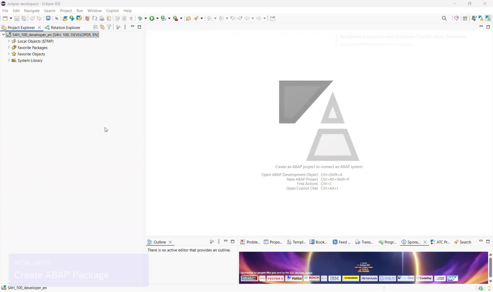

# Create ABAP Package in ADT

**Demonstration · 28 seconds**

This demonstration shows how to create the root ABAP package `ZDR_JOULE` in ABAP Development Tools (ADT). Creating a Structure package is the first step of the installation procedure and is required before registering the repository in abapGit. The demonstration covers the package creation dialog, the required field values and how to confirm the correct package type is selected.

[Download full-quality demonstration (MP4)](../../assets/videos/installation/01-create-abap-package-in-adt.webp.mp4)

---

[← Back to installation guide: Create the root ABAP package](../installation.md#1-create-the-root-abap-package)
