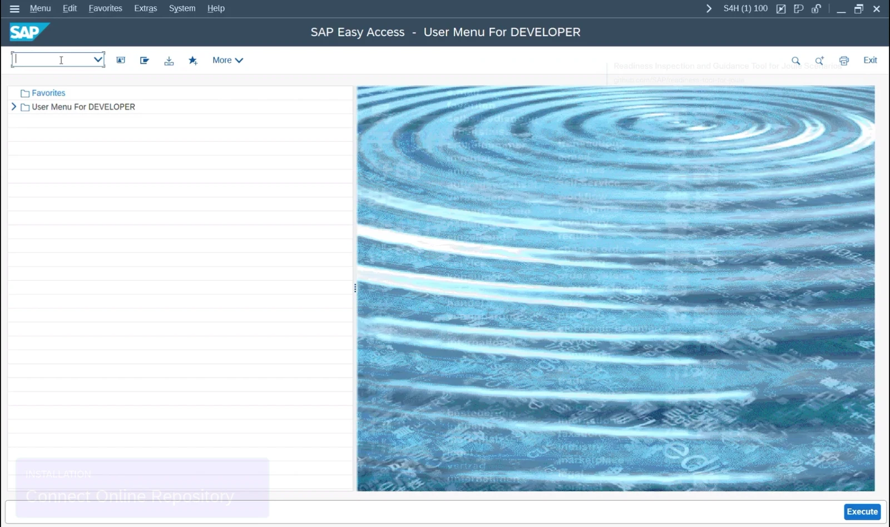

# Create Online Repository in abapGit

**Demonstration · 28 seconds**

This demonstration shows how to register the Readiness Tool for Joule Scenarios repository as an online repository in abapGit using `ZABAPGIT_STANDALONE`. It covers the New Online dialog, the required field values including the Git URL, package, branch and folder logic, and the initial repository creation and authentication step. This demonstration covers steps 1–4 of the repository registration procedure.

[Download full-quality demonstration (MP4)](../../assets/videos/installation/02-create-online-repository-in-abapgit.mp4)

---

[← Back to installation guide: Register the repository in abapGit](../installation.md#2-register-the-repository-in-abapgit)
