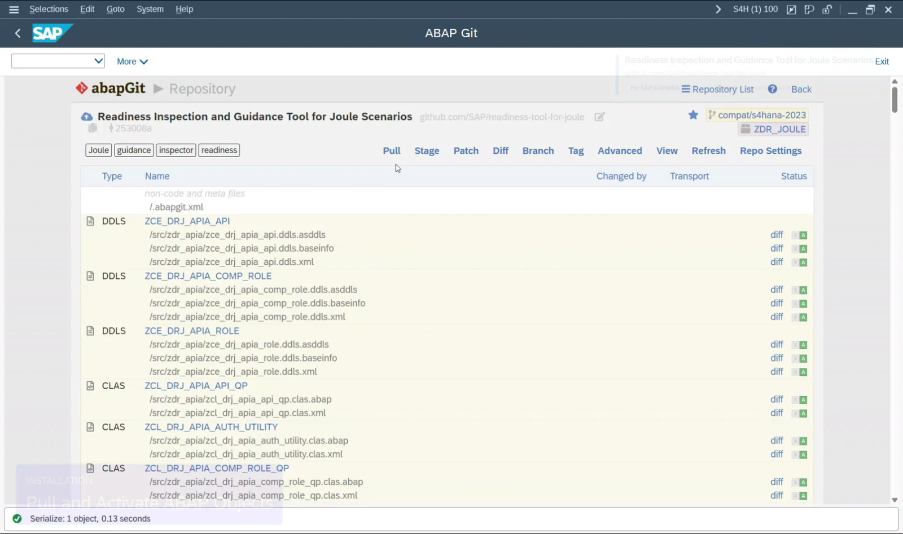

# Pull and Activate ABAP Objects

**Demonstration · 58 seconds**

This demonstration shows how to pull the repository content from abapGit and activate the imported ABAP objects. It covers reviewing the object list, selecting Pull, handling the transport request and working through the Inactive Objects screen, including deselecting the Service Binding `ZAPI_JOULECAPABILITY_O2` so it can be activated manually in the following step. This demonstration covers steps 5–6 of the repository registration procedure.

[Download full-quality demonstration (MP4)](../../assets/videos/installation/03-pull-and-activate-abap-objects.mp4)

---

[← Back to installation guide: Register the repository in abapGit](../installation.md#2-register-the-repository-in-abapgit)
