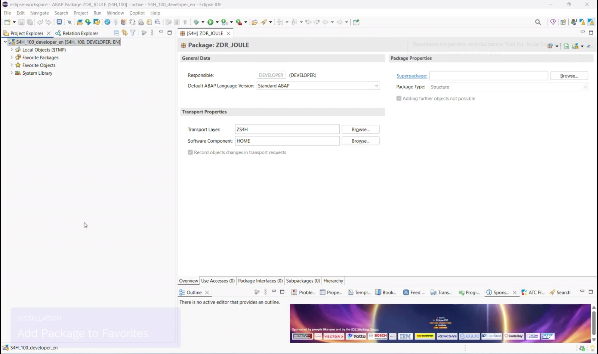

# Add Package to ADT Favourites (Optional)

**Demonstration · 31 seconds**

This optional demonstration shows how to add the `ZDR_JOULE` package to the ADT Favourites view for quicker navigation during installation and future maintenance. Right-clicking the package in the Project Explorer and selecting Add to Favourites makes it immediately accessible without browsing the full package hierarchy. This step is not required for the installation to succeed.

[Download full-quality demonstration (MP4)](../../assets/videos/installation/04-add-package-to-favorites-optional.mp4)

---

[← Back to installation guide: Add package to ADT Favourites](../installation.md#add-package-to-adt-favourites-optional)
