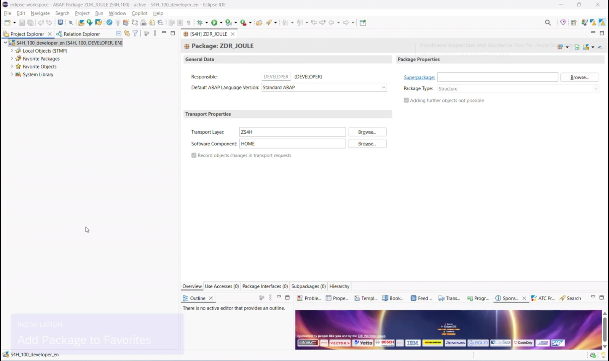

# Add Package to ADT Favorites

**Demonstration · 31 seconds**

This demonstration shows how to add the `ZDR_JOULE` package to the ADT Favorites view in Eclipse. Adding the package to Favorites is a preparatory step before locating the Service Definition `ZAPI_JOULECAPABILITY` in the package tree. Right-clicking **Favorite Packages** and selecting **Add Package** makes the package hierarchy immediately accessible without browsing the full package tree.

[Download full-quality demonstration (MP4)](../../assets/videos/installation/04-add-package-to-favorites.mp4)

---

[← Back to installation guide: Activate and publish the OData service](../installation.md#3-activate-and-publish-the-odata-service)
