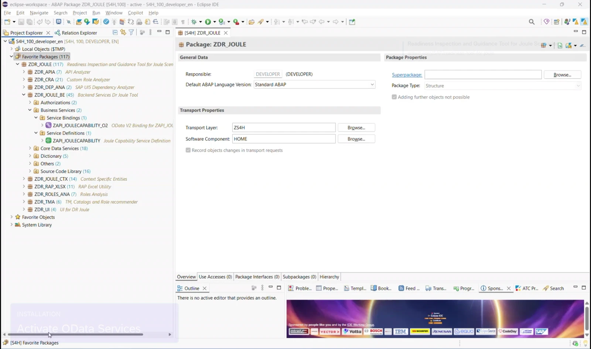

# Activate OData Service in ADT

**Demonstration · 37 seconds**

This demonstration shows how to manually activate the Service Definition `ZAPI_JOULECAPABILITY` and the Service Binding `ZAPI_JOULECAPABILITY_O2` using ABAP Development Tools. Both artefacts must be activated separately using their exact names; the Service Definition does not carry the `_O2` suffix. Activating these objects resolves the expected service binding error that appears during the abapGit import and is a required step before the tool can function.

[Download full-quality demonstration (MP4)](../../assets/videos/installation/05-activate-odata-service-in-adt.mp4)

---

[← Back to installation guide: Activate the OData service artefacts](../installation.md#3-activate-the-odata-service-artefacts)
