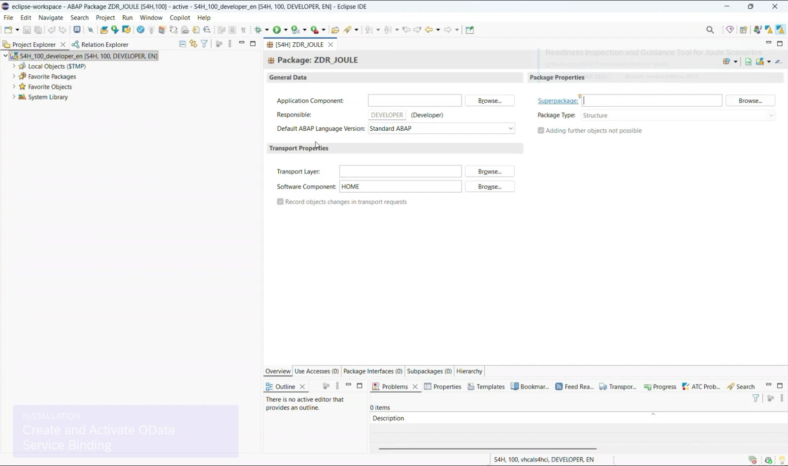

# Create and Activate OData Service Binding in ADT

**Demonstration · 1 minute 3 seconds**

This demonstration shows the complete process of creating and activating the OData V2 Service Binding for the Readiness Tool for Joule Scenarios in SAP S/4HANA 2023.

Because the Service Binding `ZAPI_JOULECAPABILITY_O2` is not delivered through abapGit in this compatibility branch, it must be created manually. The demonstration covers:

- Locating the Service Definition `ZAPI_JOULECAPABILITY` in the ADT package tree
- Activating the Service Definition
- Creating a new Service Binding with Binding Type **OData V2 - UI**
- Assigning a Workbench transport request
- Activating the new Service Binding (Ctrl+F3)
- Publishing the exposed OData service

> **Note:** ADT may recommend OData V4 during binding creation. This tool requires **OData V2 - UI** — do not change the Binding Type.

[Download full-quality demonstration (MP4)](../../assets/videos/installation/05-create-and-activate-odata-service-binding-in-adt.mp4)

---

[← Back to installation guide: Activate and publish the OData service](../installation.md#3-activate-and-publish-the-odata-service)
