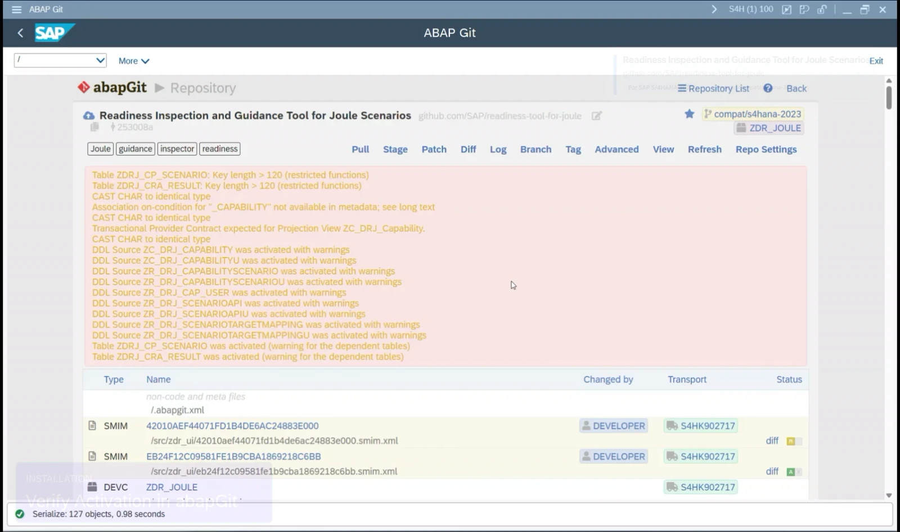

# Verify Repository Status in abapGit

**Demonstration · 16 seconds**

This demonstration shows how to refresh the repository view in abapGit after manually activating the OData service artefacts and confirm that the earlier service binding error no longer appears. A clean repository status at this point confirms the ABAP objects are correctly active and the installation is ready to continue with the PFCG role import.

[Download full-quality demonstration (MP4)](../../assets/videos/installation/06-verify-repository-status-in-abapgit.mp4)

---

[← Back to installation guide: Activate the OData service artefacts](../installation.md#3-activate-the-odata-service-artefacts)
