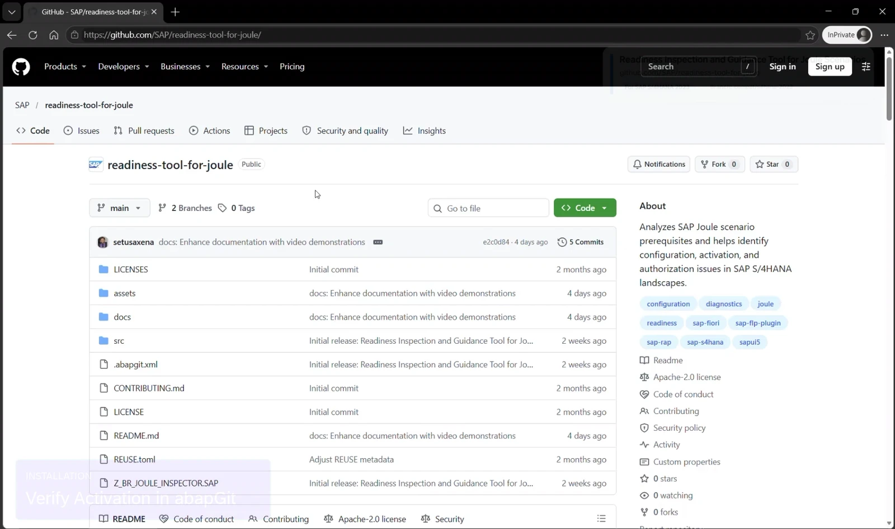

# Download Authorisation Role from GitHub

**Demonstration · 18 seconds**

This demonstration shows how to download the `Z_BR_JOULE_INSPECTOR.SAP` role export file from the approved GitHub release for the Readiness Tool for Joule Scenarios. Obtaining the role file from the correct release is the first step before importing it into the SAP system using transaction `PFCG`. Always verify the release version against the currently approved installation documentation before downloading.

[Download full-quality demonstration (MP4)](../../assets/videos/installation/07-download-authorization-role-from-github.mp4)

---

[← Back to installation guide: Import and assign the PFCG role](../installation.md#4-import-and-assign-the-pfcg-role)
