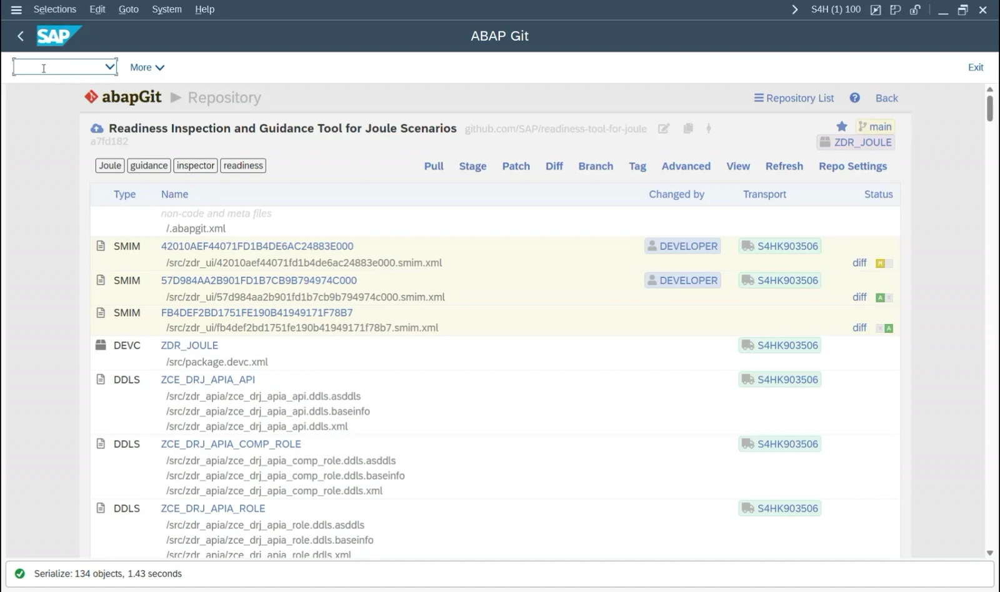

# Import and Assign Authorisation Role

**Demonstration · 1 minute 2 seconds**

This demonstration covers the complete process of importing `Z_BR_JOULE_INSPECTOR.SAP` into the SAP system using transaction `PFCG`, maintaining the authorisation data, generating the profile and assigning the role to test users. It also shows running User Comparison to synchronise user master records and verifying that the tool appears in the SAP Fiori Launchpad shell bar for an authorised user. Completing this step finalises the installation. This demonstration covers steps 2–7 of the PFCG role procedure.

[Download full-quality demonstration (MP4)](../../assets/videos/installation/08-import-and-assign-authorization-role.mp4)

---

[← Back to installation guide: Import and assign the PFCG role](../installation.md#4-import-and-assign-the-pfcg-role)
