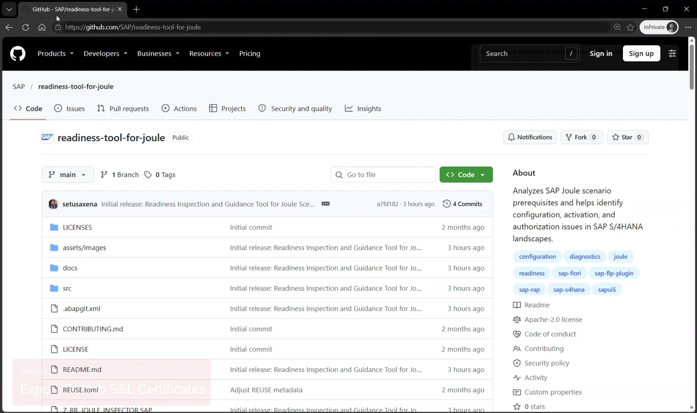

# Exporting the GitHub CA Certificates from the Browser

**Demonstration · 40 seconds**

This demonstration shows how to export the GitHub CA certificate chain from a browser for subsequent import into SAP STRUST. It covers locating the certificate details in the browser's security panel, navigating the certificate hierarchy and exporting the relevant CA certificates. The certificate chain shown is specific to the recorded environment; verify the correct certificates for your SAP landscape with your IT and security team before following these steps.

[Download full-quality demonstration (MP4)](../../assets/videos/troubleshooting/troubleshooting-export-github-ssl-certificates.mp4)

---

[← Back to troubleshooting guide: abapGit cannot establish a trusted HTTPS connection](../troubleshooting.md#abapgit-cannot-establish-a-trusted-https-connection)
