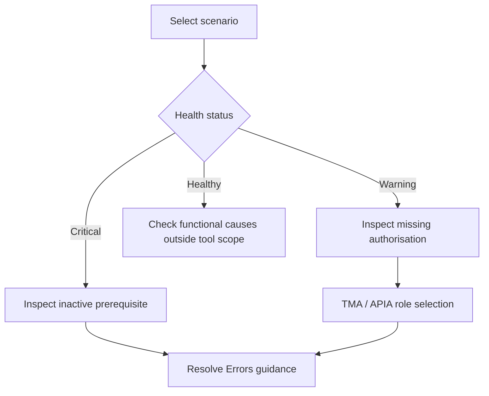

# 🔄 Common workflows

These workflows correspond to the journeys in the User Guide & Feature Reference. They describe what to investigate, not automated changes made by the plug-in.

## A Joule scenario is not working for a user

1. Open the plug-in from the FLP shell bar and locate the capability in **Capabilities Overview**.
2. Open the capability, then select the affected scenario in **Scenarios Overview**.
3. In **Individual Scenario Detail**, identify inactive APIs/IBN targets or unauthorised requirements.
4. **If inactive:** open **Resolve Errors** and follow the activation guidance for the relevant artefact.
5. **If active but unauthorised:** open **Analyze Missing OData Auth** (APIA) or **Analyze Missing IBN Targets** (TMA).
6. Select and **Save Selection** for suitable business/composite roles.
7. Return to **Resolve Errors** to review the resulting instructions and saved role recommendations; copy or email the guidance to the responsible administrator.
8. After remediation is performed through normal SAP processes, refresh the diagnostic views.

## Investigate another user without changing settings

1. From **Capabilities Overview**, select **Switch User**.
2. Find and select the context user; confirm the simulation banner is visible.
3. Inspect capabilities, scenarios and underlying API/IBN artefacts in the selected user's context.
4. Use TMA/APIA if a role appears to be missing.
5. Return to the overview and choose **Cancel Simulation** to revert.

Context simulation is **read-only**; it does not assign roles or change user settings.

## Review basic role coverage at scale

1. Open **Custom Role Analyser** from the overview.
2. Supply one or more business roles using type-ahead or Excel import.
3. Use **Standard** mode by default; only use **Background** mode when the documented prerequisites are met.
4. Run the analysis and open its results from **Analysis History**.
5. Filter by role, capability, scenario or coverage status.
6. Select a matrix cell to inspect missing requirements.

See [authorisation analysis](authorisation.md#custom-role-analyser-cra) for important scope limitations.

## Refresh reference data

Download the relevant capability-reference Excel file from SAP Note 3523238, import it through **Capability Data Sync**, and check **Import History → View Logs**. The separate **Joule Admin Center** import serves scenario visibility information; see [data synchronisation](data-sync.md).

[← Documentation index](README.md)
